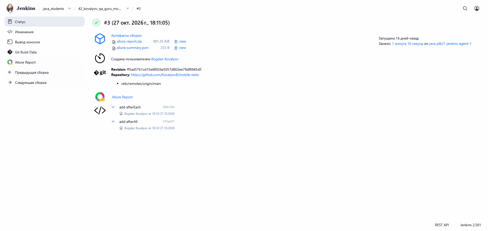
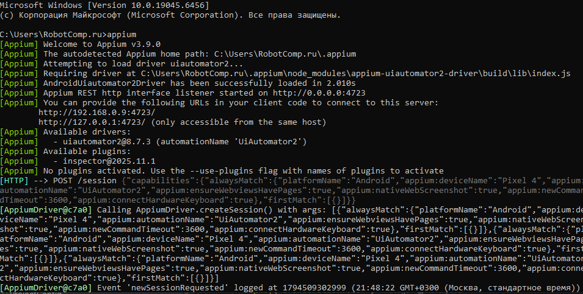
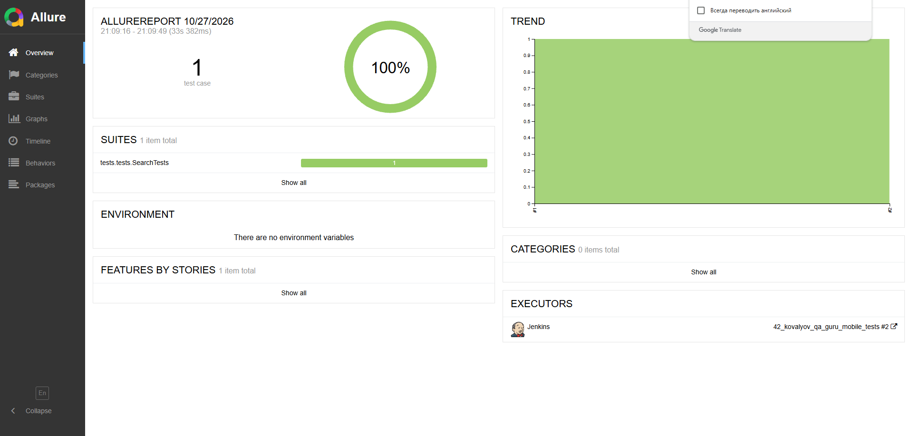
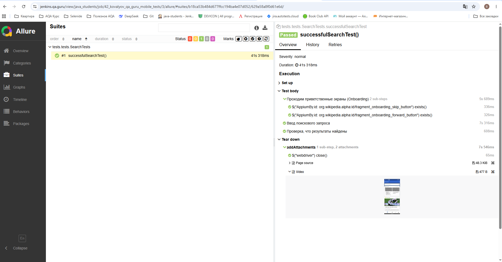
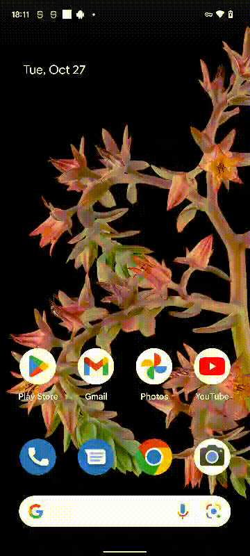

# Проект автоматизации мобильных тестов для приложения Wikipedia

<p align="center">
  <a href="https://ru.wikipedia.org/">
    
  </a>
</p>

> **Википедия** — общедоступная многоязычная универсальная интернет-энциклопедия со свободным контентом, реализованная на принципах вики.

---

## 📋 Содержание

- [Технологии и инструменты](#-технологии-и-инструменты)
- [Тестовые сценарии](#-тестовые-сценарии)
- [Архитектура и подход](#-архитектура-и-подход)
- [Сборка в Jenkins](#-сборка-в-jenkins)
- [Allure отчет](#allure)
- [Видеопример прохождения тестов BrowserStack](#movie)

---

## 🛠 Технологии и инструменты

| | Инструмент | Назначение |
|:---:|------------|------------|
|  | **Java** | Язык разработки |
|  | **IntelliJ IDEA** | IDE |
|  | **Gradle** | Сборка проекта |
|  | **JUnit 5** | Тестовый фреймворк |
|  | **Appium** | Мобильная автоматизация |
|  | **BrowserStack** | Облачная платформа для запуска |
|  | **Allure Report** | Отчётность |
|  | **Allure TestOps** | Управление тестами |
|  | **Jenkins** | CI/CD |
|  | **Jira** | Трекер задач |
|  | **Telegram** | Уведомления |
|  | **GitHub** | Хранение кода |

---

## ✅ Тестовые сценарии

- ✔️ Проверка стартовой страницы при запуске приложения
- ✔️ Проверка функции поиска в Википедии
- ✔️ Проверка загрузки целевой страницы и всех ожидаемых блоков wiki

---

## 🏗 Архитектура и подход

- **Язык:** Java
- **Фреймворк:** Selenide с паттерном **Page Screens**
- **Сборщик:** Gradle
- **Тестовый фреймворк:** JUnit 5
- **Запуск:** Android Studio, BrowserStack, драйвер Appium
- **Отчётность:** Allure Report — для каждого удалённого теста прикреплено видео прохождения

---

## ⚙️ Сборка [Jenkins](https://jenkins.qa.guru/view/java_students/job/42_kovalyov_qa_guru_mobile_tests/3/)
##  Сборка в Jenkins

<p align="center">

</p>

---

<a id="console"></a>
## :rocket: Команды для запуска

### Локальный запуск (через эмулятор)

```bash
gradle clean test -Dhost=local 
```

> Для запуска локальных тестов требуются следующие установленные программы на компьютере: Appium Server, Appium и Android Studio
<p align="center">  
  
</p> 
Пример запуска Appium сервера, с созданием локального порта.

### Удаленный запуск (через browserstack)

```bash
clean test -DdeviceHost=browserstack
```

---

<a id="allure"></a>
## 📊 [Allure](https://jenkins.qa.guru/view/java_students/job/42_kovalyov_qa_guru_mobile_tests/3/allure/) отчет
##  Интеграция с Allure Report

## 🖨️ Основная страница отчёта

<p align="center">  
  
</p>  

## 📄 Тест-кейсы

<p align="center">  
   
</p>

---

<a id="movie"></a>
## </a> Видеопример выполнения теста c Browserstack


<p align="center">
   
</p>
